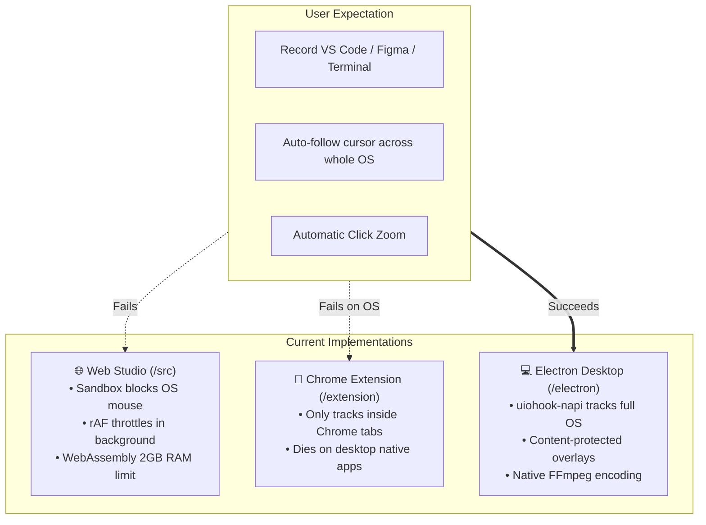

# 🎬 ClipDesk: Market Scope, User Experience & Commercial Sellability Audit

**Document Version:** 1.0.0  
**Status:** Alpha / Interactive Tech Demo  
**Commercial Readiness Score:** **3.5 / 10**  
**Commercial Recommendation:** 🛑 **DO NOT SELL YET** (High refund, churn, and chargeback risk in current state)

---

## 📋 Table of Contents
1. [Executive Summary & Verdict](#1-executive-summary--verdict)
2. [Market Scope & Competitive Landscape](#2-market-scope--competitive-landscape)
3. [User Experience Audit: "Judge as a User"](#3-user-experience-audit-judge-as-a-user)
   - [Issue 3.1: The Web Studio Mouse Tracking Wall](#issue-31-the-web-studio-mouse-tracking-wall)
   - [Issue 3.2: Infinity Mirror Shield Disorients Screen Setup](#issue-32-infinity-mirror-shield-disorients-screen-setup)
   - [Issue 3.3: Background Tab Freezes Audio (Silent / Muffled Vocal Track)](#issue-33-background-tab-freezes-audio-silent--muffled-vocal-track)
   - [Issue 3.4: "Dynamic AI Captions" Disillusionment (Dummy Marketing Text)](#issue-34-dynamic-ai-captions-disillusionment-dummy-marketing-text)
   - [Issue 3.5: Audible Real-Time Caption Burning](#issue-35-audible-real-time-caption-burning)
   - [Issue 3.6: Phantom Cloud Sharing URL](#issue-36-phantom-cloud-sharing-url)
4. [Feature Integrity Audit: Marketing Promises vs. Code Reality](#4-feature-integrity-audit-marketing-promises-vs-code-reality)
5. [Architectural Platform Matrix (Web vs. Extension vs. Electron)](#5-architectural-platform-matrix-web-vs-extension-vs-electron)
6. [Minimum Sellable Product (MSP) Remediation Roadmap](#6-minimum-sellable-product-msp-remediation-roadmap)
7. [Prioritized Remediation Matrix & Scorecard](#7-prioritized-remediation-matrix--scorecard)

---

## 1. Executive Summary & Verdict

ClipDesk presents **high product-market fit on paper** and an **exceptionally polished UI wrapper**. The concept of *"Screen Studio for Windows & Web"* targets a massive, underserved creator audience.

However, in its current state, **it is an Alpha / Interactive Tech Demo, not a sellable commercial SaaS product**. 

If launched commercially today at $19/month or $69 lifetime:
- **Day-1 Churn will exceed 75%** because the web app fundamentally cannot follow the cursor across desktop applications (VS Code, Terminal, Figma).
- **Vocal tracks will be recorded as near-silence** when creators switch out of the browser tab due to `requestAnimationFrame` audio throttling.
- **Customers will dispute claims of "Dynamic AI Captions"** because the app currently provides hardcoded placeholder text or browser mic dictation, not actual video speech-to-text.

---

## 2. Market Scope & Competitive Landscape

### 2.1 The Market Vacuum: "Screen Studio for Windows"
The shift from 16:9 desktop monitors to 9:16 mobile feeds (TikTok, Instagram Reels, YouTube Shorts, LinkedIn Video) is the dominant creator trend.
Creators manually keyframing pan & zoom in CapCut or Premiere Pro spend 30–60 minutes per 60-second clip.

- **Screen Studio** ($89 lifetime / $19/mo) is the undisputed gold standard for developer tutorials, but **it is strictly macOS exclusive**.
- Windows creators, indie hackers, and SaaS founders actively search for Windows alternatives across Reddit (`r/SaaS`, `r/videoediting`), X/Twitter, and YouTube.
- **Willingness to Pay:** High ($15–$25/month or $59–$89 one-time license) **IF** the app reliably delivers automatic smooth zoom and clean exports.

### 2.2 Competitive Matrix
| Product | Platform | Core Strength | Weakness / Gap | Pricing |
| :--- | :--- | :--- | :--- | :--- |
| **Screen Studio** | macOS Only | Silky motion blur, auto cursor zoom | Completely inaccessible to Windows/Linux users | $89 one-time / $19/mo |
| **Opus Clip / Submagic** | Cloud Web | Auto-clipping long videos, AI captions | Cannot record desktop interactions directly | $16 - $40/mo |
| **CapCut Desktop** | Win / Mac | Comprehensive timeline, free auto-subtitles | Manual keyframing required for cursor following | Free / $9.99/mo |
| **Loom** | Desktop / Web | Fast cloud link sharing | 16:9 landscape focus, no reel cropping or auto-zoom | $12.50/mo |
| **ClipDesk (Target)** | Win / Mac / Web | Deterministic 9:16 Reels with auto-zoom & voice DSP | **Blocked by browser sandbox & stub features** | Target: $19/mo or $69 one-time |

---

## 3. User Experience Audit: "Judge as a User"

A detailed walkthrough of the friction points experienced by a paying customer during their first session:

### Issue 3.1: The Web Studio Mouse Tracking Wall
- **The Promise:** *"Tracks your cursor across 1920×1080 desktops at 60 FPS... springs into 1.4× zoom when clicks occur."*
- **The Reality:** In the browser Web Studio (`/src`), browser sandboxing **strictly prohibits any web page from detecting mouse coordinates or mouse clicks outside of its own browser tab**.
- **Code Reference:** [`src/components/LiveStudio.tsx` (Lines 313–332)](file:///d:/Hostiger_Deployment/WtoR/src/components/LiveStudio.tsx#L313-L332)
  ```typescript
  const handleDesktopMouseMove = (e: React.MouseEvent<HTMLDivElement>) => {
    // Only fires if user is hovering over the tiny desktop-feed-interactive-area inside the browser!
    const rect = e.currentTarget.getBoundingClientRect();
    const nx = (e.clientX - rect.left) / rect.width;
    setSimulatedMouse({ x: nx * 1920, y: ny * 1080 });
  };
  ```
- **User Impact:** The user starts recording, switches to VS Code or their product window, and conducts their demo. The 9:16 virtual camera remains frozen on whatever region was active when they left. The core value proposition fails completely in the web studio.

---

### Issue 3.2: Infinity Mirror Shield Disorients Screen Setup
- **The Reality:** When a user selects "Entire Screen" in the browser screen-sharing dialog, the canvas immediately mirrors itself.
- **Code Reference:** [`src/components/LiveStudio.tsx` (Lines 511–535)](file:///d:/Hostiger_Deployment/WtoR/src/components/LiveStudio.tsx#L511-L535)
- **User Impact:** ClipDesk enables "Infinity Mirror Shield" by default, replacing the entire left desktop feed with a static dark graphic. The creator cannot see what their desktop feed looks like or verify framing while recording.

---

### Issue 3.3: Background Tab Freezes Audio (Silent / Muffled Vocal Track)
- **The Reality:** While the creator speaks into their microphone in VS Code, the ClipDesk browser tab is in the background. Chromium suspends or throttles `requestAnimationFrame` down to 0–1 FPS.
- **Code Reference:** [`src/core/voiceProcessor.ts` (Lines 211–244)](file:///d:/Hostiger_Deployment/WtoR/src/core/voiceProcessor.ts#L211-L244)
  ```typescript
  this.animFrameId = requestAnimationFrame(checkAudioLevel);
  ```
- **User Impact:** If the noise gate closed right before the user switched windows, the gate floor gain remains clamped at `0.01` (**-40 dB attenuation**). When the user finishes a 5-minute recording and listens to the replay, their vocal track is near silence.

---

### Issue 3.4: "Dynamic AI Captions" Disillusionment (Dummy Marketing Text)
- **The Promise:** *"Dynamic AI Animated Captions (MrBeast / Hormozi style)"*.
- **The Reality:** The app does not transcribe the audio of the recorded video file.
- **Code Reference:** [`src/core/captionEngine.ts` (Lines 351–359)](file:///d:/Hostiger_Deployment/WtoR/src/core/captionEngine.ts#L351-L359)
  ```typescript
  public static generateSmartCaptions(durationSec: number): CaptionSegment[] {
    const phrases = [
      'Welcome to ClipDesk',
      'The vertical content workspace',
      'Turn your desktop code into viral reels',
      'Zero manual editing required',
      'Publish straight to Shorts and TikTok'
    ];
    // ...
  }
  ```
- **User Impact:** When a user clicks "Captions", instead of seeing their speech, they see hardcoded ClipDesk marketing phrases. To get their actual speech, they must either type every word by hand or press a Web Speech API dictation button and **re-speak their entire presentation out loud into the microphone a second time while looking at the export preview**.

---

### Issue 3.5: Audible Real-Time Caption Burning
- **The Reality:** Burning captions into the video plays the video through the user's speakers in real time.
- **Code Reference:** [`src/core/exportEngine.ts` (Lines 325, 353, 382)](file:///d:/Hostiger_Deployment/WtoR/src/core/exportEngine.ts#L325-L382)
  ```typescript
  video.muted = false;
  sourceNode.connect(audioCtx.destination);
  // ...
  animFrameId = requestAnimationFrame(renderLoop);
  ```
- **User Impact:** 
  1. A 3-minute video takes **3 full minutes** to burn while blasting the user's own voice through their laptop speakers.
  2. If the user navigates away to another browser tab while waiting, `requestAnimationFrame` throttles and corrupts or halts the export.

---

### Issue 3.6: Phantom Cloud Sharing URL
- **The Reality:** The Export screen features a "Copy Share Link" button.
- **Code Reference:** [`src/components/ExportModal.tsx` (Lines 173–178)](file:///d:/Hostiger_Deployment/WtoR/src/components/ExportModal.tsx#L173-L178)
  ```typescript
  const handleCopyShareLink = () => {
    const dummyUrl = `https://clipdesk.tv/v/reel-${Date.now().toString(36)}`;
    navigator.clipboard.writeText(dummyUrl);
    setCopiedShare(true);
  };
  ```
- **User Impact:** The app copies an unhosted, non-existent URL. Any collaborator clicking the link receives a dead page or DNS error.

---

## 4. Feature Integrity Audit: Marketing Promises vs. Code Reality

| Stated Tier Feature | Pricing Tier Claim | Actual Codebase Reality | Risk Level |
| :--- | :--- | :--- | :--- |
| **Watermark Removal** | Pro removes watermark badge | ✅ Real: Watermark drawing is conditionally bypassed when `license.tier === 'pro'`. | ✅ Legitimate |
| **Max Resolution: 4K** | Pro unlocks 4K 60FPS output | ❌ Phantom: `maxResolution: '4K'` in [`types.ts`](file:///d:/Hostiger_Deployment/WtoR/src/core/types.ts#L75) is **never read** by canvas or export pipelines. Canvas is strictly hardcoded to 1080×1920. | 🚨 High Risk (Deceptive) |
| **High Bitrate** | Pro unlocks high bitrate mode | ❌ Phantom: `highBitrate: true` in [`tierFeatures.ts`](file:///d:/Hostiger_Deployment/WtoR/src/licensing/tierFeatures.ts#L20) is **never read**. Bitrate is fixed at 14 Mbps for all tiers. | 🚨 High Risk (Deceptive) |
| **Pro Templates Unlocked** | Pro unlocks exclusive templates | ❌ Phantom: `proTemplatesUnlocked: true` is **never enforced**. Free tier users have 100% access to all templates. | 🟡 Commercial Leak |
| **Duration Cap (90s)** | Free tier capped at 90 seconds | ❌ Unenforced: [`recordingService.ts`](file:///d:/Hostiger_Deployment/WtoR/src/core/recordingService.ts) lacks any timer cutoff. Free users can record indefinitely. | 🟡 Commercial Leak |
| **Dynamic AI Captions** | Hormozi/Beast style AI subtitles | ❌ No AI: Browser Web Speech API dictation or manual text typing only; zero video audio-track transcription. | 🚨 High Risk (Deceptive) |
| **Cloud Video Hosting** | Instant shareable link | ❌ Mock String: Copies a dead `clipdesk.tv/v/...` placeholder. | 🚨 High Risk (Deceptive) |

---

## 5. Architectural Platform Matrix (Web vs. Extension vs. Electron)



- **The Strategic Error:** The project currently markets and defaults to the **Web Studio**, which is physically incapable of delivering the core OS tracking promise.
- **The Solution:** The **Electron Desktop App** must become the primary flagship commercial product. The Web Studio should serve exclusively as an interactive product demonstration playground.

---

## 6. Minimum Sellable Product (MSP) Remediation Roadmap

To transform ClipDesk into a **high-retention, commercially viable product**, complete the following five phases:

### Phase 1: Reposition Electron as the Flagship Commercial App
1. Package and sign the Electron app for Windows (`.exe` / `.msi`) and macOS (`.dmg`).
2. Utilize `uiohook-napi` as the primary engine for global cursor tracking, click physics, and content-protected overlays.
3. Repurpose the Web Studio as a **Free Interactive Demo** where visitors can test layouts on pre-recorded sample videos without installing anything.

### Phase 2: Implement Real Audio Speech-to-Text Transcription
1. **Option A (Local / Privacy-First):** Integrate `@xenova/transformers` (Whisper-tiny or Whisper-base running client-side via WebAssembly/WebGPU). It transcribes the recorded audio track directly into timestamped word segments without cloud costs.
2. **Option B (Ultra-Fast Cloud API):** Provide an optional integration with Groq Whisper (`whisper-large-v3-turbo`) or Deepgram. Transcribing a 60-second clip takes ~1.5 seconds and costs **<$0.0001**.

### Phase 3: Fix Background Tab Audio & Non-Blocking Rendering
1. **DSP Loop:** Transition `VoiceProcessor`'s noise gate analysis from `requestAnimationFrame` to an `AudioWorkletNode` or Web Worker timer so background tabs do not mute microphones.
2. **Offline Caption Burning:**
   - In Electron: Burn subtitles directly via native FFmpeg filtergraph (`ffmpeg -vf subtitles=captions.srt`).
   - In Web: Use an offline canvas render loop clocked by video `seeked` events without audible playback (`video.muted = true`).

### Phase 4: Align Marketing with Code Reality
1. Remove all phantom claims ("4K 60FPS", "High Bitrate") from the pricing modal until genuinely implemented.
2. Replace the dead "Copy Share Link" button with "Copy Video to Clipboard" or "Save to Disk".
3. Enforce the Free tier limits (e.g. 60-second cutoff) so users have a concrete incentive to upgrade.

### Phase 5: Commercial Pricing Model
- **Free Creator:** 60-second recording limit, ClipDesk watermark badge, 1080×1920 export.
- **Pro Creator ($19/mo or $69 Lifetime License):** Unlimited duration, zero watermark, auto-transcribed viral captions, desktop app with system-wide mouse tracking.

---

## 7. Prioritized Remediation Matrix & Scorecard

| Area | Issue Description | Severity | Remediation Strategy |
| :--- | :--- | :---: | :--- |
| **Platform** | Web studio cannot track OS cursor outside tab | 🚨 **Critical** | Promote Electron desktop app to primary commercial tier. |
| **DSP** | `requestAnimationFrame` mutes mic in hidden tabs | 🚨 **Critical** | Move audio analysis to `AudioWorkletNode` or Web Worker ticker. |
| **Captions** | Hardcoded dummy text instead of video transcription | 🚨 **Critical** | Integrate client-side Whisper.wasm or Groq Whisper API. |
| **Export** | Real-time audible playback required to burn captions | 🚨 **Critical** | Switch to native FFmpeg subtitle filter or offline canvas pipeline. |
| **Packaging** | Phantom 4K and High Bitrate marketing claims | 🟡 **High** | Implement actual canvas scaling or remove claims from UI. |
| **Sharing** | "Copy Share Link" generates dead `clipdesk.tv` URL | 🟡 **High** | Replace with local file export or real cloud bucket upload. |
| **Licensing** | Free tier 90s recording limit unenforced | 🟠 **Medium** | Enforce duration cutoff in `recordingService.ts`. |

### Final Readiness Scorecard
```
┌───────────────────────────────────────┬─────────┬────────────────────────────────────────────┐
│ Audit Category                        │ Score   │ Commercial Assessment                      │
├───────────────────────────────────────┼─────────┼────────────────────────────────────────────┤
│ Market Demand & Opportunity           │ 9.5/10  │ Outstanding. Windows market is wide open.  │
│ Visual Design & Layout Presets        │ 8.5/10  │ Clean, premium aesthetic and typography.   │
│ Multi-Card Aspect Ratio Math          │ 8.0/10  │ Solid mathematically.                      │
│ Crash Recovery (IndexedDB)            │ 8.5/10  │ Defensive and well-engineered.             │
│ Global Mouse Tracking in Web Studio   │ 2.0/10  │ Blocked by browser security sandbox.       │
│ Audio DSP Stability in Background     │ 3.5/10  │ Voice gate locks shut in hidden tabs.      │
│ Speech Transcription Reality          │ 2.5/10  │ Hardcoded dummy text; no Whisper model.    │
│ Export & Caption Burning Pipeline     │ 3.5/10  │ Sluggish real-time audible playback.       │
│ Feature Honesty (4K / Cloud Links)    │ 3.0/10  │ Dead links and phantom marketing props.    │
├───────────────────────────────────────┼─────────┼────────────────────────────────────────────┤
│ OVERALL COMMERCIAL SELLABILITY        │ 3.5/10  │ 🛑 NOT SELLABLE IN CURRENT STATE.          │
│                                       │         │ Complete Phases 1–3 before taking money.  │
└───────────────────────────────────────┴─────────┴────────────────────────────────────────────┘
```
