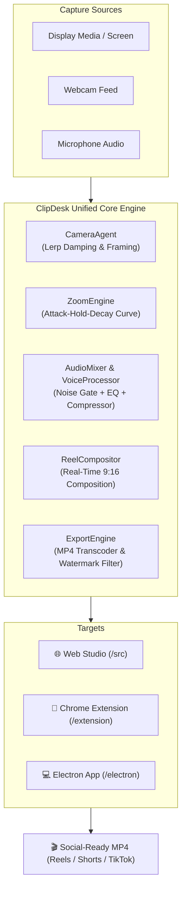

<div align="center">

# 🎬 ClipDesk

### *OBS for Reels — The Vertical Content Workspace for Desktop Creators*

Turn widescreen desktop recordings into viral, studio-grade 9:16 vertical videos for **Instagram Reels**, **YouTube Shorts**, and **TikTok** — with zero manual editing required.

<br/>

[](https://react.dev)
[](https://www.typescriptlang.org)
[](https://vitejs.dev)
[](https://www.electronjs.org)
[](https://developer.chrome.com/docs/extensions/)
[](https://ffmpeg.org)
[](https://github.com)

<br/>

[✨ Features](#-key-features) •
[📊 Platform Matrix](#-platform-comparison) •
[🏗️ Architecture](#️-architecture--engine-flow) •
[🚀 Quick Start](#-getting-started) •
[⌨️ Shortcuts](#️-keyboard-shortcuts) •
[🌐 Hostinger Deployment](#-deployment-to-hostinger)

---

</div>

## ✨ Key Features

<table>
  <tr>
    <td width="50%">
      <h3>🎯 Dynamic Cursor Follow & Click Zoom</h3>
      <p>Intelligently tracks your pointer across 1920x1080 screens at 60 FPS using calibrated Lerp damping. Automatically springs into smooth 1.4x zoom during clicks to highlight details.</p>
    </td>
    <td width="50%">
      <h3>🎙️ Studio Voice Enhancer</h3>
      <p>Built-in Web Audio DSP featuring real-time noise gating, speech-optimized 3-band EQ, and dynamic compressor to deliver podcast-grade voiceover clarity.</p>
    </td>
  </tr>
  <tr>
    <td width="50%">
      <h3>🎥 Draggable Camera Bubble</h3>
      <p>Circular webcam picture-in-picture with customizable border gradients, quick size toggles (Small / Medium / Large), horizontal mirror flip, and drag-and-drop placement.</p>
    </td>
    <td width="50%">
      <h3>📐 Intelligent Reel Layouts</h3>
      <p>Choose from <b>Follow Cursor</b> (dynamic 9:16 crop), <b>Blurred Backdrop</b> (ambient glow), <b>Gradient Mesh</b>, or <b>16:9 Classic</b> (Loom-style landscape).</p>
    </td>
  </tr>
  <tr>
    <td width="50%">
      <h3>✏️ Live Pen & Telestrator</h3>
      <p>Annotate and highlight directly on your live capture. Strokes fade cleanly after 4 seconds and render directly into the recorded video stream.</p>
    </td>
    <td width="50%">
      <h3>🔒 100% Private & Local-First</h3>
      <p>No backend servers, no tracking, and no cloud uploads. Video encoding happens completely in-browser or on-desktop via FFmpeg.</p>
    </td>
  </tr>
</table>

---

## 📊 Platform Comparison

ClipDesk is engineered as a unified trifecta for creators across the browser, web extension, and native desktop:

| Feature / Capability | 🌐 Web Studio | 🧩 Chrome Extension | 💻 Electron Desktop |
| :--- | :---: | :---: | :---: |
| **Zero Installation** | ✅ Instant | ⚙️ Load Unpacked | 📦 Native Installer |
| **Output Ratio** | 9:16 Vertical & 16:9 | 9:16 Vertical & 16:9 | 9:16 Vertical & 16:9 |
| **Cursor Follow Scope** | Canvas Preview | Any Chrome Web Page | **Entire Desktop & Any App** |
| **Click Tracking** | Canvas Events | Browser Events | **Native Global Hook (`uiohook`)** |
| **Floating Controls Bar** | Pop-Out Window | Shadow DOM on Page | **Always-On-Top Content-Protected** |
| **UI Hidden from Video** | ✅ | *(Needs minimize)* | **✅ Protected from capture** |
| **System Audio Capture** | Browser Share | Tab Audio | **Native System Audio (Win)** |
| **Encoding Engine** | MediaRecorder + WASM | MediaRecorder + WASM | **Local Bundled Static FFmpeg** |

---

## 🏗️ Architecture & Engine Flow



---

## 🚀 Getting Started

<details open>
<summary><b>1. 🌐 Web Studio (Local Development)</b></summary>
<br/>

Run the standalone Web Studio in your local browser:

```bash
# Install dependencies
npm install

# Start Vite dev server
npm run dev
# -> http://localhost:5173
```

> **Note:** HTTPS or `localhost` is required by modern browsers to grant screen and camera capture permissions.

</details>

<details>
<summary><b>2. 🧩 Chrome Extension (Loom-style Background Capture)</b></summary>
<br/>

The Chrome Extension records active tabs or entire screens in the background with floating page controls:

```bash
# Build the Manifest V3 extension bundle
npm run build:ext
# Output generated in: dist-extension/
```

**Loading into Chrome:**
1. Navigate to `chrome://extensions` in Google Chrome or Microsoft Edge.
2. Toggle on **Developer mode** in the top-right corner.
3. Click **Load unpacked** and select the [`dist-extension`](file:///d:/Hostiger_Deployment/WtoR/dist-extension) folder.
4. Pin **ClipDesk** to your browser toolbar, click its icon, and grant camera/mic permissions once.

</details>

<details>
<summary><b>3. 💻 Electron Desktop Application (Native Overlay & Global Capture)</b></summary>
<br/>

The Desktop app tracks cursor coordinates across all OS windows with content-protected floating controls hidden from the recorded output:

```bash
# Run in development
npm run desktop

# Build standalone distribution installer (.exe / .dmg / .AppImage)
npm run dist:desktop
# Output generated in: dist-desktop/
```

**Features unique to Desktop:**
- Native floating camera bubble that floats over VS Code, browsers, and terminal apps.
- Controls window is invisible to screen capture using OS window affinity protection.
- Automatically saves recordings straight to `Videos/ClipDesk`.

</details>

---

## ⌨️ Keyboard Shortcuts

| Shortcut | Action | Description |
| :--- | :--- | :--- |
| <kbd>Alt</kbd> + <kbd>Shift</kbd> + <kbd>P</kbd> | **Pause / Resume** | Instantly toggle recording state |
| <kbd>Alt</kbd> + <kbd>Shift</kbd> + <kbd>S</kbd> | **Stop & Save** | Complete the recording and launch export preview |
| <kbd>Alt</kbd> + <kbd>Shift</kbd> + <kbd>D</kbd> | **Draw / Telestrator** | Activate pen mode in Web Studio |

---

## 🌐 Deployment to Hostinger

ClipDesk has no server-side backend dependencies, making it deployable to static web hosting, CDN, or Hostinger shared hosting:

```bash
# Create optimized production build
npm run build
# Output generated in: dist/
```

### Steps for Hostinger:
1. Log into your **hPanel** dashboard and verify **SSL Certificate** is active on your domain (`https://`).
2. Open **File Manager** → navigate to `public_html/` (or your desired subfolder).
3. Upload all files and folders from [`dist/`](file:///d:/Hostiger_Deployment/WtoR/dist), ensuring the included [`.htaccess`](file:///d:/Hostiger_Deployment/WtoR/public/.htaccess) file is uploaded.
4. Visit your site over `https://yourdomain.com`.

---

## 🧪 Testing & Verification

Run the core engine test suite to validate camera math, lerp damping curves, audio graph mixing, and FFmpeg filtergraphs:

```bash
node scripts/verify_engines.mjs
```

---

<div align="center">
  <sub>Built with ❤️ for SaaS Founders, Developers, Teachers & Content Creators.</sub>
</div>
