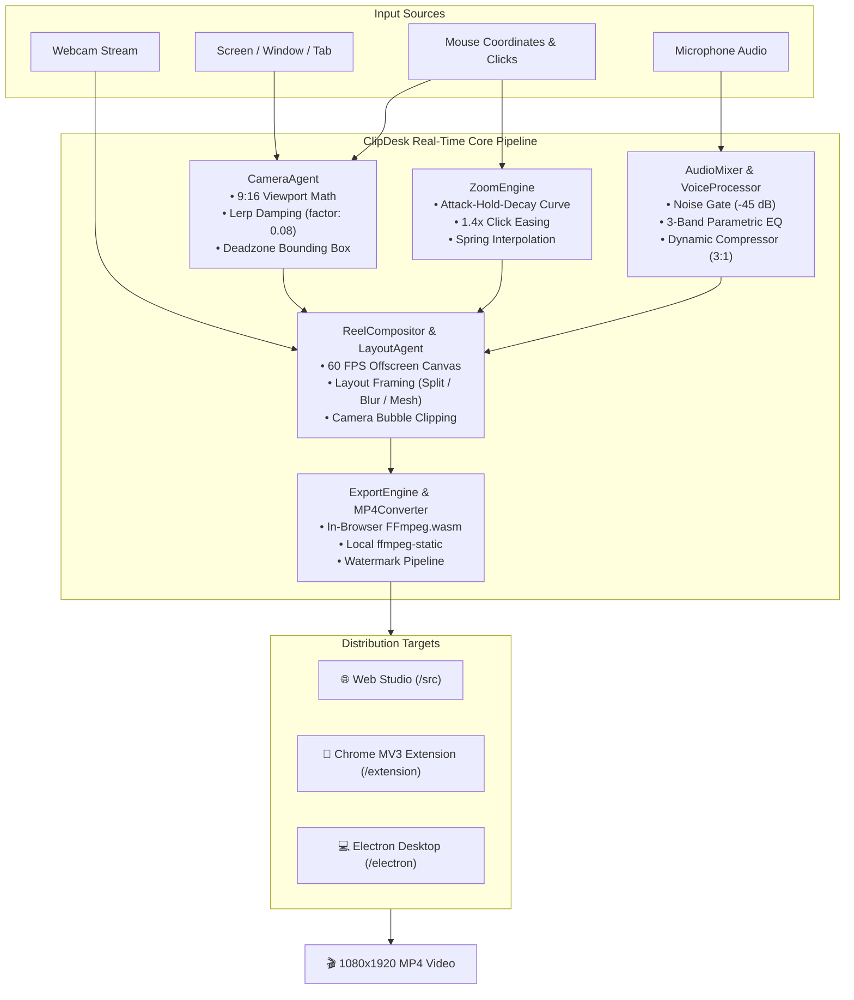

<div align="center">

# 🎬 ClipDesk

### *OBS for Reels — The Vertical Content Workspace for Desktop Creators*

Turn widescreen (16:9) desktop and browser recordings into viral, studio-grade 9:16 vertical videos for **Instagram Reels**, **YouTube Shorts**, and **TikTok** — with zero manual editing, keyframing, or cropping required.

<br/>

[](https://react.dev)
[](https://www.typescriptlang.org)
[](https://vitejs.dev)
[](https://www.electronjs.org)
[](https://developer.chrome.com/docs/extensions/)
[](https://ffmpeg.org)
[](https://tailwindcss.com)
[](https://github.com)

<br/>

[📖 Overview](#-overview--product-vision) •
[✨ Key Features](#-key-features) •
[🧠 Core Engines Deep Dive](#-core-engines-deep-dive) •
[📊 Platform Ecosystem](#-platform-ecosystem--matrix) •
[📂 Project Structure](#-project-structure) •
[🚀 Getting Started](#-getting-started--developer-guide) •
[⌨️ Shortcuts](#️-keyboard-shortcuts) •
[🌐 Hostinger Deployment](#-deployment-to-hostinger) •
[🛠️ Troubleshooting](#️-troubleshooting--os-permissions)

---

</div>

## 📖 Overview & Product Vision

Creators, SaaS founders, and software developers build and demonstrate software on **widescreen (16:9) displays** (1920×1080 or larger). However, modern audience discovery happens predominantly on **vertical (9:16) feeds** like TikTok, Instagram Reels, and YouTube Shorts.

Traditionally, converting widescreen desktop screen recordings into high-converting vertical shorts required:
1. Importing massive screen recordings into Premiere Pro, Final Cut, or CapCut.
2. Manually keyframing pan and zoom to keep the mouse pointer centered.
3. Manually cropping and positioning the webcam bubble.
4. Manually layering blurred background duplicates or aesthetic frames.
5. Exporting and compressing for mobile feeds.

**ClipDesk eliminates this manual editing loop entirely.** Using a deterministic, mathematical real-time compositor running at 60 FPS, ClipDesk automates camera following, click-triggered zoom, speech audio enhancement, circular camera bubble picture-in-picture, and multi-layout rendering directly on your machine.

### Who is ClipDesk for?
- **SaaS Founders & Marketers:** Record quick feature teasers, updates, and conversion-focused product demos.
- **Developers & Engineers:** Show off terminal workflows, code snippets, git diffs, and pull request walkthroughs.
- **Educators & Course Creators:** Record step-by-step tutorials without needing a video editing team.
- **Technical Advocates:** Create fast social snippets of documentation, browser tools, and CLI utilities.

---

## ✨ Key Features

<table>
  <tr>
    <td width="50%">
      <h3>🎯 Dynamic Cursor Follow & Auto-Zoom</h3>
      <p>Tracks your cursor across 1920×1080 desktops at 60 FPS using calibrated Lerp damping (<code>factor = 0.08</code>). Automatically springs into smooth 1.4× zoom when clicks occur to emphasize interface interactions.</p>
    </td>
    <td width="50%">
      <h3>🎙️ Studio Voice DSP Enhancer</h3>
      <p>Built-in Web Audio digital signal processing pipeline with a real-time noise gate (-45 dB), 3-band voice EQ (low cut, presence boost, air), and dynamic compressor to output crisp, podcast-grade voice-overs.</p>
    </td>
  </tr>
  <tr>
    <td width="50%">
      <h3>🎥 Draggable Camera Bubble</h3>
      <p>Circular webcam PIP with glowing animated borders, quick size toggles (Small: 180px, Medium: 220px, Large: 280px), one-click horizontal mirror flipping, and fluid drag-and-drop boundary clamping.</p>
    </td>
    <td width="50%">
      <h3>📐 Intelligent Reel Layouts</h3>
      <p>Choose from <b>Follow Cursor</b> (dynamic 9:16 crop), <b>Blurred Backdrop</b> (ambient glow with 25px Gaussian blur), <b>Gradient Mesh</b> (modern aesthetic card framing), or <b>16:9 Classic</b> (Loom-style landscape).</p>
    </td>
  </tr>
  <tr>
    <td width="50%">
      <h3>✏️ Live Pen & Telestrator</h3>
      <p>Draw and highlight directly on your live capture during tutorials. Strokes fade gracefully after 4 seconds and are rendered straight into the final recording canvas.</p>
    </td>
    <td width="50%">
      <h3>🔒 100% Private & Local-First</h3>
      <p>Zero cloud uploads, zero telemetry, and zero backend servers. All compositing and FFmpeg MP4 encoding executes completely on your device.</p>
    </td>
  </tr>
</table>

---

## 🧠 Core Engines Deep Dive

ClipDesk is engineered around specialized modular agents located in [`src/core/`](file:///d:/Hostiger_Deployment/WtoR/src/core):



### 1. `CameraAgent` (`src/core/cameraAgent.ts`)
- **Aspect Ratio Transformation:** Calculates a vertical 9:16 crop window (default 608×1080 source area) from any 1920×1080 widescreen display.
- **Lerp Damping:** Rather than snapping abruptly to cursor movement, the camera applies Linear Interpolation (`lerp(current, target, 0.08)`) at 60 FPS to prevent viewer motion sickness.
- **Deadzone Filtering:** Includes a centered bounding box deadzone so minor cursor tremors don't cause jitter.
- **Edge Boundary Clamping:** Clamps camera coordinates within `[0, sourceWidth - cropWidth]`, guaranteeing that no black voids appear outside the screen area.

### 2. `ZoomEngine` (`src/core/zoomEngine.ts`)
- **Click Detection Physics:** When the creator clicks their mouse, the zoom engine triggers an **Attack-Hold-Decay** envelope:
  - **Attack Phase (0–150ms):** Smooth ease-out zoom from 1.0× to 1.4× centered on the click coordinate.
  - **Hold Phase (150–350ms):** Maintains 1.4× zoom while interaction finishes.
  - **Decay Phase (350–750ms):** Eases gently back to standard framing (1.0×).

### 3. `AudioMixer` & `VoiceProcessor` (`src/core/audioMixer.ts`, `src/core/voiceProcessor.ts`)
- **Web Audio DSP Chain:**
  - **Noise Gate:** Suppresses room noise and keyboard clatter when volume drops below -45 dB with customizable 10ms attack and 150ms release.
  - **Voice EQ:** High-pass filter cuts sub-80Hz desk rumble; 2.5kHz peaking boost adds vocal clarity; 10kHz high-shelf brings crisp broadcast air.
  - **Compressor:** Smooth 3:1 ratio with fast 10ms attack prevents audio clipping during loud speaking moments.
  - **Stereo Mixer:** Blends system audio (desktop sound) with mic voiceover into a unified stereo stream.

### 4. `LayoutAgent` & `ReelCompositor` (`src/core/layoutAgent.ts`, `src/core/reelCompositor.ts`)
- **Real-Time Canvas Compositing:** Renders all layers at 60 FPS into an offscreen canvas:
  1. **Background Layer:** Ambient blur, gradient background, or solid fill.
  2. **Screen Capture Layer:** Dynamic 9:16 crop with smooth cursor focus.
  3. **Pen Annotation Layer:** Real-time fading telestrator strokes.
  4. **Camera Bubble Layer:** Clipped circular webcam video with glowing border stroke.
  5. **Branding Layer:** Creator handle and optional Pro watermark badge.

### 5. `ExportEngine` & `Mp4Converter` (`src/core/exportEngine.ts`, `src/core/mp4Converter.ts`)
- **Native MP4 Recording:** Uses browser native H.264/MP4 encoding where available (Chrome 126+, Safari).
- **Client-Side Transcoding:** Where browser only outputs WebM, client-side `@ffmpeg/ffmpeg` (Wasm) converts the media into high-bitrate H.264/AAC MP4 on-device with zero server compute.
- **Desktop Hardware Acceleration:** In the Electron app, bundled `ffmpeg-static` converts recordings near-instantaneously without browser memory limits.

---

## 📊 Platform Ecosystem & Matrix

ClipDesk comes in three specialized versions sharing the exact same core rendering architecture:

| Feature / Capability | 🌐 Web Studio | 🧩 Chrome Extension (MV3) | 💻 Electron Desktop App |
| :--- | :---: | :---: | :---: |
| **Installation Required** | None (instant web URL) | Load Unpacked in Chrome | Native Installer (.exe / .dmg / .AppImage) |
| **Display Aspect Ratio** | 9:16 Vertical & 16:9 | 9:16 Vertical & 16:9 | 9:16 Vertical & 16:9 |
| **Cursor Tracking Scope** | Inside Preview Window | Any Chrome Web Page | **Entire Desktop & Any Native App** |
| **Mouse Click Tracking** | DOM Click Events | Browser Event Listener | **Global OS Hook (`uiohook-napi`)** |
| **Floating Controls UI** | Document PiP Window | Shadow DOM Injected Bar | **Always-On-Top Native Transparent Window** |
| **UI Hidden From Video** | ✅ Yes | *(Must minimize bar)* | **✅ Yes (`setWindowContentProtection`)** |
| **Desktop System Audio** | Browser Prompt Share | Tab Audio Capture | **Native Loopback System Audio (Win)** |
| **Offline Transcoding** | In-Browser WebAssembly | In-Browser WebAssembly | **Bundled Local Static FFmpeg** |
| **Recording Save Target** | Browser Download | Browser Download | **Direct to `Videos/ClipDesk` folder** |

---

## 📂 Project Structure

```
WtoR/
├── .github/                   # CI/CD and repository workflows
├── .gitignore                 # Excludes node_modules, build artifacts, logs
├── index.html                 # Web Studio entry point
├── package.json               # Project manifest, dependencies, and build scripts
├── tsconfig.json              # TypeScript compilation rules
├── README.md                  # Comprehensive interactive project documentation
├── wide2Short.md              # Original specification and product vision blueprint
│
├── src/                       # 🌐 Web Studio & Shared Core Engines
│   ├── main.tsx               # Web Studio bootstrap
│   ├── App.tsx                # Main app state machine (welcome -> setup -> studio)
│   ├── index.css              # Tailwind CSS 4 styling and animations
│   ├── components/            # React UI components
│   │   ├── TopNav.tsx                 # Navigation bar and Pro status indicator
│   │   ├── WelcomeScreen.tsx          # Hero landing screen & template selector
│   │   ├── RecordingSetup.tsx         # Source picker, camera toggle, mic selector
│   │   ├── LiveStudio.tsx             # Live 60 FPS studio recording workspace
│   │   ├── VerticalCanvas.tsx         # Real-time 9:16 preview canvas renderer
│   │   ├── FloatingRecordingBar.tsx   # Floating recording controls bar
│   │   ├── FocusPicker.tsx            # Manual focus point selector
│   │   ├── FramingOverlay.tsx         # Interactive crop grid overlay
│   │   ├── BubbleStyleControls.tsx    # Webcam border and size adjustment modal
│   │   ├── CountdownOverlay.tsx       # 3-2-1 animated countdown overlay
│   │   ├── ExportModal.tsx            # Export preview, transcode progress, download
│   │   └── UpgradeModal.tsx           # Pro creator licensing dialog
│   ├── core/                  # 🧠 Deterministic Real-Time Engines
│   │   ├── types.ts                   # Core interfaces and data structures
│   │   ├── cameraAgent.ts             # 9:16 viewport math & 60 FPS Lerp damping
│   │   ├── zoomEngine.ts              # Attack-Hold-Decay click-zoom physics
│   │   ├── audioMixer.ts              # Web Audio API multi-stream mixer
│   │   ├── voiceProcessor.ts          # Noise gate, parametric EQ, and compressor DSP
│   │   ├── focusRegion.ts             # Focus region bounding box detector
│   │   ├── frameSource.ts             # Display media and camera stream sampler
│   │   ├── layoutAgent.ts             # Layout orchestrator (Follow, Blur, Mesh, 16:9)
│   │   ├── reelCompositor.ts          # Canvas composition and frame-by-frame renderer
│   │   ├── templateManager.ts         # Pre-configured creator reel templates
│   │   ├── recordingService.ts        # Recording state machine and mock demo generator
│   │   ├── exportEngine.ts            # FFmpeg filtergraph generator & export pipeline
│   │   └── mp4Converter.ts            # In-browser WebM to H.264/AAC converter via Wasm
│   └── licensing/             # 👑 Monetization & Entitlements
│       ├── licenseService.ts          # Offline key validation & localStorage cache
│       └── tierFeatures.ts            # Free vs. Pro entitlement matrices
│
├── extension/                 # 🧩 Chrome Extension (Manifest V3)
│   ├── public/
│   │   ├── manifest.json      # MV3 configuration, permissions, background worker
│   │   └── icons/             # 16px, 32px, 48px, 128px extension icons
│   ├── permissions.html       # Camera & mic one-time grant tab
│   ├── popup.html             # Toolbar popup interface
│   ├── recorder.html          # Pinned background offscreen recording tab
│   ├── result.html            # Completed recording review and download page
│   └── src/
│       ├── background.ts      # Extension service worker coordinator
│       ├── content.ts         # Injected shadow-DOM floating controls bar
│       ├── popup.tsx          # React popup setup wizard
│       ├── recorder.ts        # Background tab capture & stream compositing
│       ├── result.ts          # Download and review handlers
│       └── shared.ts          # Extension IPC message contracts & IndexedDB storage
│
├── electron/                  # 💻 Electron Desktop Application
│   ├── main.ts                # Main process, window manager, IPC, global shortcuts
│   ├── preload.ts             # Secure IPC bridge exposing window.reel API
│   ├── ffmpegManager.ts       # Bundled local static FFmpeg transcoder
│   ├── shared.ts              # Desktop state interfaces and IPC events
│   ├── launcher.html          # Initial launcher setup window
│   ├── controls.html          # Floating mini control bar overlay
│   ├── countdown.html         # Fullscreen 3-2-1 transparent countdown window
│   ├── camera.html            # Transparent draggable floating camera bubble
│   ├── recorder.html          # Hidden compositor window capturing desktop
│   ├── result.html            # Post-recording review and folder opener
│   └── src/
│       ├── launcher.tsx       # React setup window UI
│       ├── controls.ts        # Native floating bar controller
│       ├── camera.ts          # Bubble physics, resizing, and mirror toggles
│       ├── countdown.ts       # Countdown animation controller
│       ├── recorder.ts        # Desktop capture, uiohook cursor bridge, encoding
│       └── result.ts          # Review window, open in explorer, delete actions
│
└── scripts/                   # ⚙️ Build and Tooling Scripts
    ├── verify_engines.mjs     # Automated test suite validating math and engines
    ├── run-electron.mjs       # Safe Electron bootstrap clearing env flags
    └── make-extension-icons.mjs # Canvas generator for all extension icon sizes
```

---

## 🚀 Getting Started & Developer Guide

### Prerequisites
- **Node.js**: v18.0.0 or later (Node 20+ recommended)
- **npm**: v9.0.0 or later
- **Modern Browser**: Google Chrome or Microsoft Edge (Chrome 126+ recommended for native MP4 recording)

### Installation
Clone the repository and install all dependencies:
```bash
git clone https://github.com/Singhak/clipdesk.git
cd clipdesk
npm install
```

---

### Running the Targets

#### 1. 🌐 Web Studio (Browser)
Starts the local development server:
```bash
npm run dev
# Server ready at http://localhost:5173
```
- Open `http://localhost:5173` in Chrome or Edge.
- Select a template (e.g. *Coding Tutorial* or *Product Demo*).
- Configure your camera and microphone, click **Start Recording**, and pick your target screen or window.

#### 2. 🧩 Chrome Extension (Manifest V3)
Compile the extension bundle:
```bash
npm run build:ext
# Output generated in: dist-extension/
```
1. Open Chrome and navigate to `chrome://extensions`.
2. Enable **Developer mode** (top right switch).
3. Click **Load unpacked** and select the [`dist-extension/`](file:///d:/Hostiger_Deployment/WtoR/dist-extension) folder.
4. Pin **ClipDesk** to your toolbar.
5. Click the extension icon and click **Allow camera & mic** once to grant persistent permissions.

#### 3. 💻 Electron Desktop Application
Launch the desktop application in developer mode:
```bash
npm run desktop
```
Build standalone distributable installers:
```bash
npm run dist:desktop
# Generates native installer inside dist-desktop/ (e.g., "ClipDesk Setup 1.0.0.exe")
```

---

### Automated Engine Validation
Run the built-in mathematical verification suite to validate camera tracking math, lerp damping curves, audio graph mixing, and FFmpeg filtergraphs:
```bash
node scripts/verify_engines.mjs
```
```
🧪 Starting ClipDesk Engine Validation Tests...

▶ Testing CameraAgent (9:16 Crop & Lerp Damping)...
  ✔ Camera Lerped smoothly from 960 -> 1133.2 towards 1200

▶ Testing ZoomEngine (Attack-Hold-Decay Curve)...
  ✔ Attack phase at 100ms: Zoom is 1.350x
  ✔ Hold phase at 300ms: Zoom holds at 1.40x
  ✔ Decay phase at 700ms: Zoom is 1.200x

▶ Testing ExportEngine (FFmpeg Pipeline Filtergraph)...
  ✔ Free tier watermark filter validated
  ✔ Pro tier watermark-free pipeline validated

▶ Testing Licensing & Subscription Logic...
  ✔ Pro license keys verified with instant validation

✨ ALL ENGINES, CAMERA METRICS & WEBCAM ALGORITHMS VALIDATED! 100% PASSING.
```

---

## ⌨️ Keyboard Shortcuts

ClipDesk features built-in shortcuts accessible during active recording:

| Shortcut | Scope | Action | Description |
| :--- | :--- | :--- | :--- |
| <kbd>Alt</kbd> + <kbd>Shift</kbd> + <kbd>P</kbd> | Global (Desktop) / In-Tab | **Pause / Resume** | Pauses video timer and halts frame capture |
| <kbd>Alt</kbd> + <kbd>Shift</kbd> + <kbd>S</kbd> | Global (Desktop) / In-Tab | **Stop & Export** | Finalizes the take and opens export review |
| <kbd>Alt</kbd> + <kbd>Shift</kbd> + <kbd>D</kbd> | Web Studio | **Toggle Pen** | Activates the live telestrator drawing tool |

> **Pro-Tip for Chrome Extension:** You can configure the extension shortcuts to work globally across your entire OS by visiting `chrome://extensions/shortcuts` and switching the shortcut scope from **In Chrome** to **Global**.

---

## 🌐 Deployment to Hostinger

ClipDesk is completely client-side and requires **no database, node backend, or server infrastructure**. You can host it on any static web server, Hostinger shared hosting, Cloudflare Pages, Vercel, or Netlify.

### 1. Build the Production Bundle
```bash
npm run build
# Output generated in: dist/
```

### 2. Deploy to Hostinger via hPanel
1. Log into your **Hostinger hPanel**.
2. Go to **Websites** → Select your domain → Enable your free **SSL Certificate** (browsers will deny screen/camera capture on insecure `http://`).
3. Open **File Manager** and navigate to your web root (`public_html/` or a subfolder).
4. Upload all files from the [`dist/`](file:///d:/Hostiger_Deployment/WtoR/dist) folder.
5. **Crucial:** Ensure the included [`.htaccess`](file:///d:/Hostiger_Deployment/WtoR/public/.htaccess) file is uploaded to `public_html/`. It sets the required security headers:
   ```apache
   # Required for WebAssembly FFmpeg SharedArrayBuffer support
   Header set Cross-Origin-Embedder-Policy "require-corp"
   Header set Cross-Origin-Opener-Policy "same-origin"
   ```
6. Visit `https://yourdomain.com` in your browser.

---

## 🛠️ Troubleshooting & OS Permissions

### macOS Permissions
macOS requires explicit system-level permissions for screen recording and input monitoring:
- If screen capture shows a blank black screen, open **System Settings → Privacy & Security → Screen Recording** and toggle **ClipDesk** (or Google Chrome) to **Allowed**.
- If camera or microphone fails, check **Privacy & Security → Camera / Microphone**.
- After toggling permissions on macOS, you must restart the application.

### Windows `ELECTRON_RUN_AS_NODE`
If you attempt to run `electron .` directly in VS Code's integrated terminal on Windows, you may encounter:
```
TypeError: Cannot read properties of undefined (reading 'commandLine')
```
This happens because VS Code injects `ELECTRON_RUN_AS_NODE=1` into child terminal shells. Always start the desktop app using:
```bash
npm run desktop
```
which uses [`scripts/run-electron.mjs`](file:///d:/Hostiger_Deployment/WtoR/scripts/run-electron.mjs) to automatically strip that environment variable.

### Browser Memory Limits
In the Web Studio and Chrome Extension, recorded video chunks are held in browser memory before export. For recordings longer than 20 minutes, we recommend using the **ClipDesk Desktop Application**, which streams recorded chunks directly to disk at `Videos/ClipDesk`.

---

## 📄 License & Attribution

Distributed under the MIT License. Built with ❤️ for developers, founders, and content creators.
